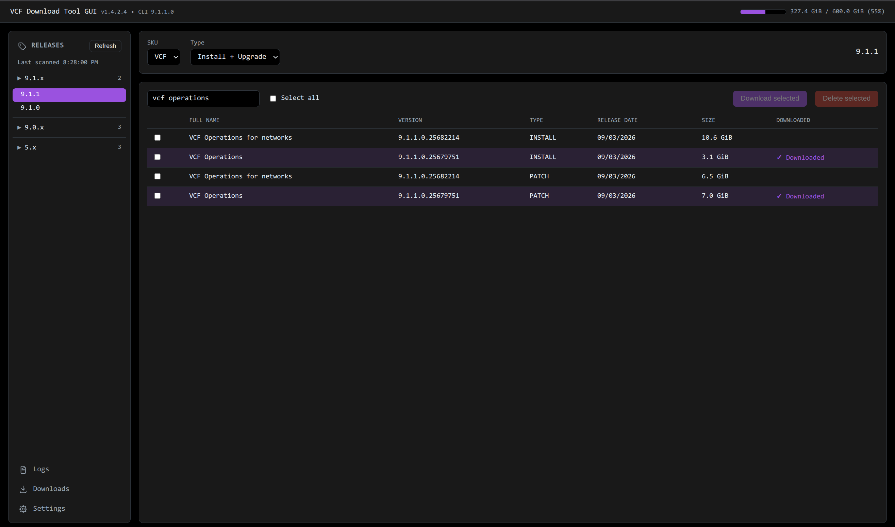
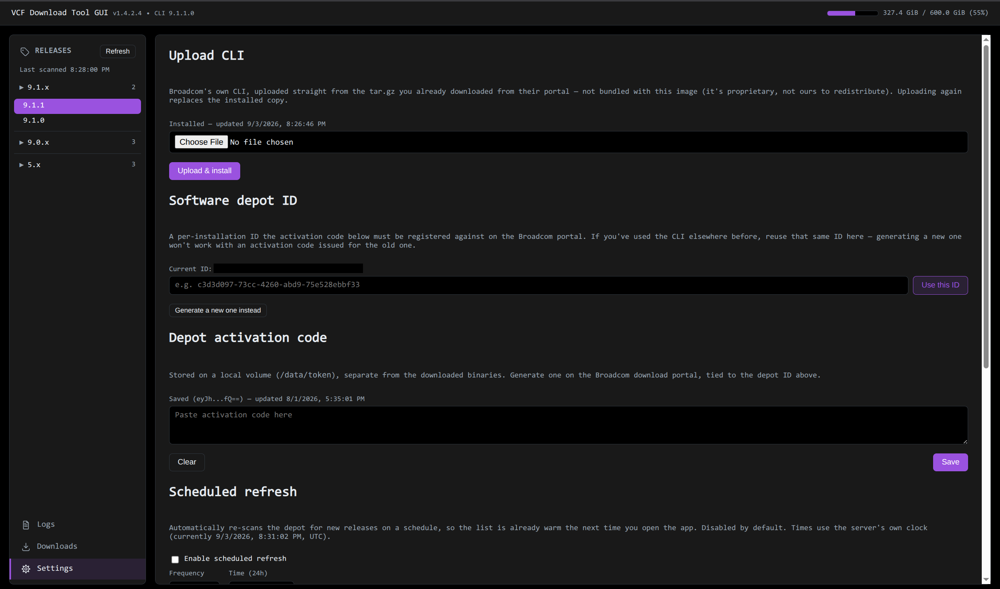
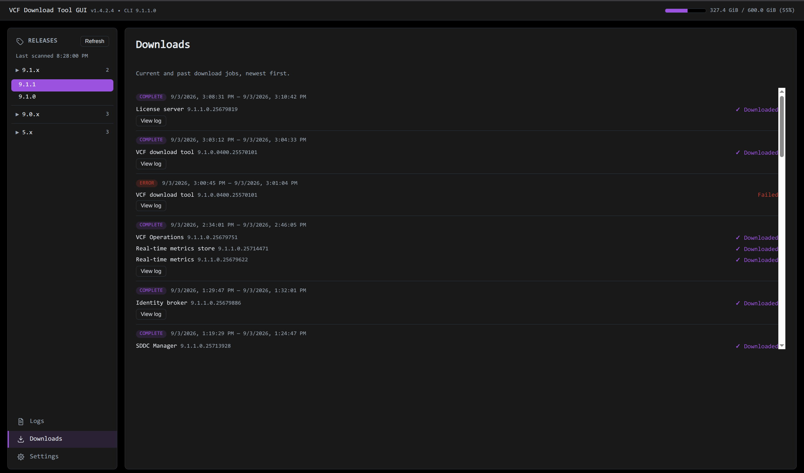

# VCF Download Tool GUI

A web GUI wrapper around Broadcom's `vcf-download-tool`, because it cant 
just be me who hates the CLI tool, cant remember the commands and wants
something pretty <3.

# VCF CLI Support
The following versions of the CLI were tested and work

- 9.1.0.0100
- 9.1.0.0400
- 9.1.1.0

# Features

- Turns the VCF download tool from Broadcom into an easy to use GUI application
- Easily generate an ID with a ready to use link for depot registration at vcf.broadcom.com
- Upload your own CLI, easily upgrades or adds CLIs from the UI
- Colour customisation - One of my favourites
- Shows downloaded files on the depot volume * Should work properly
- Shows disk usage for the downloads volume
- Containerised platform - Tested with docker, should work on K8S
- Delete files on the depot volume
- Filtered by versions
- CLI version displayed in the GUI
- Searchable downloads list
- Filter by patch/upgrade files and install files
- CLI 9.1.1+: download OCI artifacts (VKR, Supervisor, VKS, DSM, ...) via the
  new `artifacts` command, straight from the Type dropdown
- Order by release date, size and downloaded columns
- Log visibility
- ESX type: download ESXi base images, IOVP drivers, vendor add-ons and VMware Tools via `esx download`, for the ESXi platform lines you tick in the GUI
- Integrity checking: downloads are verified against Broadcom's published size and SHA-256 (from the depot's own product version catalog) after every download, truncated files show as **Incomplete**, and **Verify selected** re-checks files already on the depot

## Pictures







## Running

`docker-compose.yml` contains a default port binding and two key volumes,
the default yaml has a data directory for storing the download token when
generated, and the CLI tool which can be added and updated in the GUI.  
There is also a mount for the download data, you can have this attached
to whatever you want, I use NFS as my offline depot also mounts it,
I have included my default but you can change this out for anything that
works for you. The container runs as a fixed non-root user (UID/GID 1500) —
if you point the depot mount at an NFS export, it needs to already permit
writes from that UID (or just be world-writable, which is the common case).
```
services:
  vcf-download-tool-gui:
    image: ghcr.io/leaha00/vcf-download-tool-gui:latest
    container_name: vcf-download-tool-gui
    restart: unless-stopped
    ports:
      - "8080:8080"
    volumes:
      # Also where the CLI itself lives once you upload it through the GUI's
      # "Upload CLI" button - see README.md "Bring your own CLI". No
      # separate volume needed for it.
      - vcf-token:/data/token
      - vcf-depot:/mnt/vcf-depot
    environment:
      PORT: "8080"

volumes:
  # Local, container-host-backed volume for the activation code - kept
  # separate from the depot store on purpose.
  vcf-token:
    driver: local

  # NFS-backed volume for downloaded binaries. Requires nfs-common (or
  # equivalent) on the Docker host so the local volume driver can mount it.
  vcf-depot:
    driver: local
    driver_opts:
      type: nfs
      o: "addr=192.168.1.4,nolock,soft,rw"
      device: ":/mnt/Sol/General/vcf-depot"

```
```
docker compose up -d
```

This starts the GUI on `http://localhost:8080` with:

- `vcf-token` (local Docker volume) — holds the activation code, the
  per-installation "software depot ID", and (since v1.3.0) the CLI itself
  once you upload it. Kept separate from the downloaded binaries on purpose.
- `vcf-depot` (NFS volume) — eg `192.168.1.4:/mnt/Sol/General/vcf-depot`, where
  downloaded binaries land. Requires `nfs-common` (or equivalent) on the
  Docker host so the `local` volume driver can mount it, and `nfsvers=3`
  (this share doesn't answer on v4).

### Upgrading from before v1.5.1.3

v1.5.1.3 moved to a fixed, capability-less non-root UID/GID (1500:1500) so
the image satisfies Kubernetes' Pod Security "restricted" profile. If you're
running under plain Docker/Compose (no `user:` override), this needs no
action from you: the entrypoint still starts as root by default there, and
on every container start it self-heals an existing `vcf-token` volume's
ownership (idempotent - a fast no-op once it's already 1500:1500) before
dropping to 1500:1500 for the app itself - so upgrading straight from any
older version, including pre-1.5.1.3, "just works" on the next
`docker compose up`.

If you deploy under Kubernetes (or anywhere else that explicitly forces a
non-root UID via the container runtime, like `k8s/generic`'s
`securityContext.runAsUser`), the entrypoint never runs as root in the first
place - by design, matching Pod Security "restricted" - so it can't self-heal
an existing PVC's stale ownership from an older deployment. In that case, fix
it once with a throwaway privileged Job/pod against the same volume, e.g.:

```
docker run --rm -v <your-vcf-token-volume>:/data/token busybox chown -R 1500:1500 /data/token
```

or the equivalent one-off Kubernetes `Job` mounting the same PVC. This never
needs to touch the app's own Deployment or its security context.

## Bring your own CLI

This image doesn't and won't ever bundle Broadcom's `vcf-download-tool` -
every file in it is headed `Copyright ... Broadcom Confidential`, so it's not
ours to redistribute. There's no bind mount for it either - upload it
straight through the GUI instead:

1. Download the CLI yourself from the Broadcom portal (you need this
   regardless - it's the same login the activation code comes from). Don't
   extract it - keep the `.tar.gz` as-is.
2. In the GUI, click **Upload CLI** (top right) and choose that file.

It's extracted into the `vcf-token` volume, validated (the extracted CLI has
to actually run `--version` successfully before anything is swapped into
place), and used from there - no host filesystem access, no bind mount, no
`docker-compose.yml` changes, and it works identically in Kubernetes with
just a PVC for `/data/token` (no second PV needed for the CLI). Uploading
again later (a new Broadcom release) replaces the installed copy the same
way; the previous one is kept as a one-generation backup rather than
deleted outright.


## First-time setup

Open the GUI and click **Settings**:

1. **Software depot ID** — the CLI ties every activation code to a
   per-installation UUID that has to be registered on the Broadcom portal.
   If you've used the CLI before (e.g. on the host), paste that same ID in
   under "Current ID" rather than generating a new one — a freshly generated
   ID won't be registered against your existing activation code and auth
   will fail. Otherwise, click "Generate a new one instead" and follow the
   registration link it gives you - wait a min for the link to appear.
2. **Activation code** — paste the code from the Broadcom download portal
   and save. It's written to `/data/token/activation-code.txt` inside the
   `vcf-token` volume.

## Using it

- **Releases** panel discovers every 9.0+ VCF version dynamically by querying
  the depot with an open-ended range (`--vcf-version=9.0..`) and grouping by
  major.minor.patch family. New releases show up automatically the next time
  the cache refreshes (15 min TTL, or hit **Refresh**) — no code changes
  needed. Pre-9.0 releases (5.0, 5.1, 5.2) are listed too, but hardcoded
  rather than discovered — the depot has no component whose version tracks
  the release version for that older line the way it does from 9.0 on, so
  there's nothing to scan. That product line is done shipping new releases,
  so this isn't expected to need updates.
- **Manual version** input lets you query an arbitrary VCF version directly.
- Pick SKU (VCF/VVF) and Type, select rows by checkbox, then **Download
  selected**. Progress streams live via Server-Sent Events.
- The **Type** dropdown adapts to the installed CLI:
  - **CLI < 9.1.1** — `Install + Upgrade` / `Install` / `Upgrade`, unchanged.
  - **CLI ≥ 9.1.1** — `Install` (default) / `Patch`. The combined
    "Install + Upgrade" option is dropped, and an **OCI artifacts** group is
    added: `vSphere Kubernetes Releases (VKR)` plus the six `artifacts`
    categories (`SUPERVISOR`, `VKS`, `SUPERVISOR_SERVICE`, `VCF_CLI`,
    `VCF_SERVICE`, `DSM`). Picking one lists that content via the CLI's new
    `artifacts list`; **Download selected** runs `artifacts download` once
    per selected row (`--component-version=<v>` with the matching
    `--category`/`--component`) into the same depot store. **Downloaded**
    state is detected per component (`<depot>/PROD/COMP/<COMPONENT>/`):
    `✓ Downloaded` once the manifests and — for OCI components — the
    `<bundle>.tar` are all present, `Partial` while the `imgpkg` pull is
    incomplete or was interrupted. **Delete selected** works for artifacts
    too (removes that component-version's files + `*-images` dir).
    The OCI-image half of an artifact download runs `imgpkg` against
    `vcf.packages.broadcom.com` (token from `eapi.broadcom.com`) — both must
    be reachable from the container, on top of the usual `dl.broadcom.com`.
    The GUI shows no per-file progress for the `imgpkg` phase, so a large
    pull can look idle while it works — check the job log.
- The bar in the top center shows the depot store's disk usage (via
  `fs.statfs` on `DEPOT_DIR`), refreshing every 30s normally and every 3s
  while a download is active.
- The SKU/Type/Frequency dropdowns are custom widgets, not native
  `<select>`s — Chromium mispositions a native `<select>` popup when the app
  is embedded in the vcf-lab-toolkit iframe. The real `<select>` is still in
  the page (hidden) as the value source.

Note: the CLI only reliably supports exact version pinning for GA releases
(`a.b.c.0`); async patch builds (`a.b.c.0100`, `.0200`, ...) return nothing
when queried exactly even though they show up fine in the family listing.
The backend detects this and automatically falls back to the full
`a.b.c.x` family query, with a toast explaining what happened.
